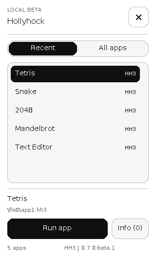

# Hollyhock Custom Launcher · local beta

**0.7.0-beta.1** brings the Compact layout to HH2 and HH3: black and white, rounded controls and a grey frame around the app list.

The launcher opens on **Recent**, with up to five apps. **All apps** is on the right and contains your full library. Drag the list or scrollbar, or use the arrow keys. Each page remembers its selection and scroll position while the launcher is open.

| Your installation | Supported apps |
| --- | --- |
| HH3 · OS 02.01.7002.0001 | `.hh3` |
| HH2 · OS 02.01.2000.0000 | `.hhk`, `.hh3`, compatible `.bin` |

HH3 apps must support your installed OS. File extensions are case-insensitive.

## Try it locally

Build and test with the commands in [Build and tests](docs/BUILD.md). Packages are written to `dist/beta/release/`, separately from the stable builds.

1. Choose the package matching your Hollyhock and OS version.
2. Back up the calculator's existing `run.bin`, then replace it with the `run.bin` from the package. Put apps in the root directory too.
3. Safely eject the calculator, disconnect USB and open the launcher as usual.

## Controls

- Tap **Recent** or **All apps**; left/right arrows switch pages.
- Tap a row or use up/down to select an app. **Run app** or **EXE** starts it.
- Drag the list to scroll. Drag the narrow scrollbar to reach distant entries quickly.
- **Info (0)** or the **0** key opens app details. Drag or use arrows to read long descriptions.
- **Clear**, **Backspace** or **X** closes details first, then the launcher.

Without a history, Recent starts empty; open All apps to launch your first app. The existing HH2/HH3 history storage is preserved. Browsing and closing never write history.

[German guide](docs/README_DE.md) · [Build and tests](docs/BUILD.md) · [Test report](docs/TEST-REPORT.txt)

This is a local beta. Automated checks cover both builds; physical HH2/HH3 testing is still pending.

Based on [YAL](https://github.com/ClasspadDev/yal), the [Hollyhock SDK](https://github.com/ClasspadDev/hollyhock-3) and the [Hollyhock 2](https://github.com/SnailMath/hollyhock-2) file formats. Earlier ClassPad styling used [CP-Canvas](https://github.com/TheRainbowPhoenix/CP-Canvas) as a reference.
