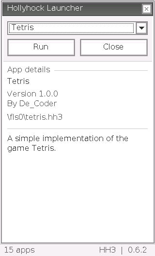

# Hollyhock Custom Launcher

Ein Launcher im ClassPad-Stil – mit App-Auswahl, Programminfos, Touch- und Tastenbedienung. **Version 0.6.2** gibt es für HH2 und HH3.

| Deine Installation | Apps | Download |
| --- | --- | --- |
| **HH3 · OS 02.01.7002.0001** | `.hh3` | [HH3-Paket](https://github.com/Loewenkrieger/Hollyhock-Custom-Launcher/releases/download/v0.6.2/hhk3-launcher-0.6.2-os7002.zip) |
| **HH2 · OS 02.01.2000.0000** | `.hhk`, `.hh3`, kompatible `.bin` | [HH2-Paket](https://github.com/Loewenkrieger/Hollyhock-Custom-Launcher/releases/download/v0.6.2/hhk2-launcher-0.6.2-os2000.zip) |

Die HH2-Ausgabe erkennt alle drei Endungen unabhängig von der Schreibweise. HH3-Apps müssen zur vorhandenen OS-Version passen.

## Installation

1. Das Paket für deine vorhandene Hollyhock-/OS-Version herunterladen.
2. Die bisherige `run.bin` sichern und durch die `run.bin` aus dem Paket ersetzen. Apps ebenfalls ins Hauptverzeichnis kopieren.
3. Sicher auswerfen, USB trennen und den Launcher wie gewohnt öffnen.

## Bedienung

App im Dropdown auswählen und mit **Run** starten. **Close**, **X** oder **Clear** schließen den Launcher. Pfeiltasten und **EXE** funktionieren ebenfalls.

Die fünf zuletzt gestarteten Apps stehen mit einem **\*** oben; die letzte App ist vorausgewählt. Der Verlauf bleibt beim nächsten Öffnen erhalten.

[Anleitung](docs/README_DE.md) · [Build und Tests](docs/BUILD.md) · [Prüfbericht](docs/TEST-REPORT.txt)

Basierend auf [YAL](https://github.com/ClasspadDev/yal), dem [Hollyhock-SDK](https://github.com/ClasspadDev/hollyhock-3) und den Dateiformaten von [Hollyhock 2](https://github.com/SnailMath/hollyhock-2).
Die Gestaltung orientiert sich an [CP-Canvas](https://github.com/TheRainbowPhoenix/CP-Canvas).
